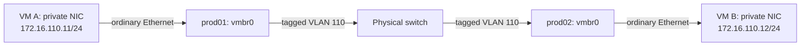

# Proxmox environment: guest configuration and design

This describes the planned VM environment on the three Proxmox nodes, how guests communicate, and how they use the host's networking and storage. The intended workloads include Kubernetes, HPC experiments, and LocalStack for learning AWS basics. Tables distinguish the network choices available to guests; examples show their behavior without prescribing a Terraform provider.

Host setup, bridge configuration, physical switch integration, repository management, and Ansible deployment remain in [CONFIGURATION.md](CONFIGURATION.md#production-nodes-proxmox-provisioning). The network profiles, bastion, NAT service, and guest templates below are plans until their implementation and validation are recorded there.

## Environment and automation ownership

| Component | Responsibility |
| --- | --- |
| Proxmox hosts: prod01, prod02, prod03 | Run guests and expose configured bridges and storage. |
| Ansible | Prepare Proxmox hosts, networking, storage, cluster services, and reusable cloud-image templates; configure software inside guests after provisioning. |
| Terraform for guests | Clone templates and define placement, CPU, RAM, disks, virtual NICs, bridge attachments, VLAN tags, and cloud-init inputs. |
| Terraform for UniFi | Configure the physical VLANs and ports connecting the Proxmox hosts. |
| Cloud-init inside a guest | Apply initial identity, SSH keys, and per-interface network configuration supplied during provisioning. |
| Netnode | Route VLAN 20 to the rest of the lab/upstream network and provide its DHCP and DNS services. |
| Bastion VM | Accept SSH from VLAN 20 and open SSH connections to attached private networks. |
| Optional NAT router | Route outbound traffic from a NAT network and translate its source addresses. This is a separate function from SSH jumping. |

Environment variables currently feed Ansible facts and switch variables. The intended inventory source is NetBox, with secrets obtained through OpenBao. Generated reservations and persistent DNS records should continue to use the same inventory rather than separate lists of host identities.

## Guest network profiles

A profile describes a guest network attachment. A VM can have no NIC, one attachment, or multiple attachments. Profile 4 is a separately addressable private network with a configured NAT gateway; it can be the VM's only NIC, as with a conventional libvirt NAT network.

| Profile | VM NICs | Access |
| --- | --- | --- |
| **1. General lab** | NIC on `vmbr0`, untagged toward the physical switch's native VLAN 20; subnet `172.16.20.0/24` | Direct lab SSH and internet through the netnode, subject to firewall rules. |
| **2. Private within one node** | NIC on a portless bridge on that node | Communication between guests attached to that bridge on the same node; SSH through a bastion attached there. No external gateway. |
| **3. Private across nodes** | NIC on `vmbr0` with Proxmox VLAN tag `110`; subnet `172.16.110.0/24` | Communication between attached guests across prod01–03; SSH through a bastion on VLAN 110. No external gateway. |
| **4. Private with NAT** | NIC on a separate private bridge/network with an outbound NAT router | Private peers within that network's reach and outbound internet. Inbound SSH through a bastion or an explicitly configured forwarding rule. |

The subnet pattern follows the lab's existing `172.16.<VLAN>.0/24` convention. VLAN 110 is an Ethernet VLAN ID; `172.16.110.0/24` is the associated private IP subnet. Those values are separate settings. Profiles 2 and 4 still need subnet and bridge-name assignments; use non-overlapping subnets for networks a guest or bastion can reach together.

A portless bridge can have the same name on multiple nodes without connecting those nodes. An isolated bridge `vmbr1` on prod01 and `vmbr1` on prod02 represents two independent networks. A shared subnet label does not change that. Moving a guest between them changes its private neighbors; placement must keep a node-local experiment and its bastion together.

## Possible guest combinations

Each selected profile normally supplies one virtual NIC. The default gateway determines destinations outside directly connected networks; private NICs without routing need an address and mask but no default gateway.

| Profiles | NIC count | Guest behavior |
| --- | --- | --- |
| None | 0 | Console access through Proxmox; no guest network connectivity. |
| **1** | 1 | VLAN 20 for management and internet; netnode is the default gateway. |
| **2** | 1 | Same-node private peers only; SSH via a bastion on that local bridge. |
| **3** | 1 | Private peers across nodes; SSH via a bastion on VLAN 110. |
| **4** | 1 | NAT network for outbound access; NAT router is the default gateway. No VLAN 20 NIC is required. |
| **1 + 2** | 2 | Direct lab management and internet through 1; same-node experiment traffic through 2. |
| **1 + 3** | 2 | Direct lab management and internet through 1; cross-node cluster traffic through 3. |
| **1 + 4** | 2 | Direct lab management plus a NAT attachment; explicitly choose one default gateway. |
| **2 + 3** | 2 | Both private networks; SSH via a bastion with a path to either attached network. No default gateway is required. |
| **2 + 4** | 2 | Same-node private experiment plus outbound internet through 4. |
| **3 + 4** | 2 | Cross-node private experiment plus outbound internet through 4. |
| **1 + 2 + 3** | 3 | VLAN 20 for management/internet; separate local and cross-node experiment interfaces. |
| **1 + 2 + 4** | 3 | Lab access, node-local private traffic, and a NAT attachment; explicitly choose one default gateway. |
| **1 + 3 + 4** | 3 | Lab access, cross-node private traffic, and a NAT attachment; explicitly choose one default gateway. |
| **2 + 3 + 4** | 3 | Both private networks; outbound internet through 4. |
| **1 + 2 + 3 + 4** | 4 | All attachments; explicitly choose one default gateway. |

Combining attachments does not automatically forward traffic between them. Keep IP forwarding disabled in ordinary guests and bastions; enable forwarding only in the designated router. Also select service listen addresses and firewall rules deliberately: a VM attached to VLAN 20 remains reachable through that NIC even if another NIC is private.

### Selecting the interface used by applications

For a profile **1 + 3** guest pair:

| Guest | Lab NIC | Private NIC | Default gateway |
| --- | --- | --- | --- |
| VM A | Example reserved address `172.16.20.121/24` | `172.16.110.11/24` | `172.16.20.1` through the lab NIC |
| VM B | Example reserved address `172.16.20.122/24` | `172.16.110.12/24` | `172.16.20.1` through the lab NIC |

These addresses are examples to reserve before use. Traffic to `172.16.110.12` follows VM A's private interface; traffic to `172.16.20.122` follows its lab interface. Configure Kubernetes/HPC services to advertise and use the private addresses when that is the intended cluster path. A second NIC alone does not move all application traffic onto it.

## How guest NICs reach the host and switch

For the VLAN-aware bridge design, the guest sees ordinary Ethernet interfaces. Terraform sets each guest NIC's Proxmox bridge and VLAN tag; it does not need to create `eth0.110` inside the VM.

| Guest attachment | Proxmox VM setting | Guest-side configuration |
| --- | --- | --- |
| Profile 1 | Bridge `vmbr0`; no explicit VLAN tag, because the switch port uses native VLAN 20 | DHCP with a reserved MAC/IP, or an explicitly managed address in `172.16.20.0/24`. |
| Profile 2 | Node-local portless bridge, illustrative name `vmbr1` | Ordinary NIC with an address in the chosen local subnet; no default gateway. |
| Profile 3 | Bridge `vmbr0`; VLAN tag `110` | Ordinary NIC with an address in `172.16.110.0/24`; no default gateway. |
| Profile 4 | NAT network's bridge, illustrative name `vmbr2` | Ordinary NIC with an address, NAT gateway, and reachable DNS resolver. |

`vmbr0` is a virtual switch that can carry several VLANs; it is not assigned exclusively to VLAN 110. Proxmox adds/removes tags at the guest attachment, while tagged traffic crosses the physical link. The host management address remains on the native VLAN 20 path.



Both private guests are in one subnet, so their conversation needs no router. The switch forwards their VLAN traffic directly. The netnode need not have a VLAN 110 interface, gateway address, or DHCP scope. An address from VLAN 20's DHCP server is not available on this isolated VLAN unless a service is explicitly added there.

This design uses a VLAN across the physical switch. VXLAN/Proxmox SDN was discussed as an alternative for transporting an isolated network across an existing IP network; it is not selected for VLAN 110. Proxmox SDN Simple zones, like portless bridges, are node-local. See [Proxmox network configuration](https://github.com/proxmox/pve-docs/blob/master/pve-network.adoc) and [SDN zone behavior](https://github.com/proxmox/pve-docs/blob/master/pvesdn.adoc).

## SSH access through the bastion

The selected access method is a dedicated bastion VM, avoiding private-subnet addresses on the Proxmox hosts. For profile 3, its two interfaces are:

| Bastion interface | Role |
| --- | --- |
| VLAN 20 | Workstation-facing SSH, updates, and the bastion's default gateway through `172.16.20.1`. |
| VLAN 110 | Direct access to private VMs; example address `172.16.110.10/24`, with no default gateway on this NIC. |


From the workstation:

```sh
ssh -J USERNAME@BASTION_VLAN20_IP user@172.16.110.11
```

Or use workstation SSH configuration:

```sshconfig
Host pe-bastion
    HostName BASTION_VLAN20_IP
    User USERNAME

Host pe-private-example
    HostName 172.16.110.11
    User user
    ProxyJump pe-bastion
```

The workstation authenticates to the bastion, which opens a TCP connection to the target. The target still authenticates the workstation's SSH identity; agent forwarding is not needed for ordinary ProxyJump use. The bastion's SSH server must permit the required TCP forwarding, and the target must accept SSH from the bastion.

SSH jumping needs neither kernel IP forwarding nor NAT. A private VM in the bastion's directly connected subnet can reply without a default gateway. For a node-local bridge, place the bastion on that same physical node and attach its private NIC to that bridge. Multiple node-local experiments may need separate bastions or deliberately combined attachments with unique subnets.

## NAT-only guests and the router boundary

Profile 4 provides the conventional one-NIC NAT VM experience:

```text
Guest's private NIC → private bridge/network → NAT router → upstream network/internet
```

The guest uses the router's private IP as its default gateway and needs a reachable DNS service. The implementation remains to be chosen: a router VM with private and upstream NICs, netnode routing on an additional VLAN, or an explicitly managed host/SDN NAT arrangement. A portless NAT bridge remains node-local unless its network is extended across nodes.

A router VM would attach upstream to VLAN 20 and downstream to the NAT network. Its role requires forwarding, firewall policy, source NAT, and any desired DHCP/DNS service. A bastion with two interfaces does not acquire those functions automatically. Outbound NAT alone does not publish guest SSH; use the bastion or explicitly configure inbound access.

Keep the isolated profile 3 separate from profile 4, or define firewall policy that enforces the difference. NAT is a gateway policy for a subnet, not a special capability of an Ethernet NIC. Connecting a guest to a NAT network must not silently grant internet access to every guest on the otherwise isolated VLAN.

## Guest disks, templates, and placement

The available local guest-disk destination is `sata-local` at `/data` on each node. The Proxmox OS and its existing `local`/`local-lvm` storage remain on each node's NVMe. NVMe brand and capacity differences do not require matching guest storage layouts.

| Storage choice | Effect on guests |
| --- | --- |
| Local `sata-local` | The selected node holds the disk. Identical storage IDs on other nodes refer to different physical disks. |
| Planned NFS or SMB/CIFS storage | All permitted nodes can access the same stored guest disks. Export/share, capacity, and server placement remain undecided. |
| External backup destination | Holds recoverable guest copies; it is separate from live shared storage and from snapshots. |

Proxmox allocates disk files under `/data/images/<VMID>/`; there is no need to create host directories named after Kubernetes or LocalStack. The VM's filesystem lives inside its virtual disk. A guest using XFS can therefore have a QCOW2 disk stored on the host's ext4 filesystem. QCOW2 is the planned local disk format for file-backed guests and supports snapshot/clone workflows. See [Directory storage](https://github.com/proxmox/pve-docs/blob/master/pve-storage-dir.adoc).

### VM templates and initial guest configuration

The plan is to make reusable templates from official generic/KVM cloud images, starting with one OS. Ansible will handle template preparation and Terraform will clone guest instances. Cloud-init inside those instances will supply initial identity, SSH access, and network settings. The initial OS/version, template IDs, build workflow, and any baked-in packages have not been selected. Packer was discussed as an optional future image-building tool. See [Proxmox cloud-init support](https://github.com/proxmox/pve-docs/blob/master/qm-cloud-init.adoc).

For guest usage, select a template and a network profile rather than repeat an interactive OS installation. Profile 1 can use DHCP reservations with a stable virtual NIC MAC. Private profiles 2 and 3 need explicitly supplied addresses until their own DHCP service exists. Selecting a cloud image does not itself provide a DHCP server on those networks.

### API access for guest provisioning

Terraform will use dedicated Proxmox API credentials to create and manage guests. A separate automation identity/token and appropriate permissions are planned; no role definition, exact privileges, provider, token name, or secret-delivery workflow has been chosen. Intended usage is guest provisioning through the API rather than interactive host SSH for every VM operation. Keep credentials out of this guide and committed VM definitions.

User/token creation and permissions belong to the platform implementation described in [CONFIGURATION.md](CONFIGURATION.md#planned-proxmox-platform-work). The later provider configuration will define how Terraform receives the endpoint and credentials.

### Migration and recovery implications

A guest using only VLAN 20 or VLAN 110 can retain that attachment on another node when the destination has matching bridge/VLAN configuration. A node-local bridge is different: its destination counterpart is another private network. Keep node-local workloads together or choose profile 3 when those peers must remain connected across placement changes.

A normal Proxmox cluster shares management configuration; it does not copy local guest disks. Planned migration may transfer disks between available nodes. Automatic restart after a failed node additionally needs recoverable storage, spare resources, and compatible networking on the recovery node. Shared NFS/SMB can supply disk access, but a single share server remains a common failure point. Proxmox HA restarts guests; it does not preserve their running memory. Kubernetes HA is a separate layer inside the guest environment.

Backups, notifications, Terraform API permissions, cluster creation, and HA implementation are tracked with the host/platform work in [CONFIGURATION.md](CONFIGURATION.md#planned-proxmox-platform-work). Their implementation must preserve the profile reachability and storage placement assumptions described here.
