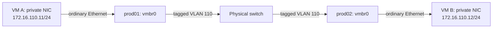

# Proxmox environment: guest configuration and design

This describes the planned VM environment on the three Proxmox nodes, how guests communicate, and how they use the host's networking and storage. The intended workloads include Kubernetes, HPC experiments, and LocalStack for learning AWS basics. Tables distinguish the network choices available to guests; examples show their behavior without prescribing a Terraform provider.

Host setup, bridge configuration, physical switch integration, repository management, and Ansible deployment remain in [CONFIGURATION.md](CONFIGURATION.md#production-nodes-proxmox-provisioning). The host template now defines `vmbr0`, `vmbr1`, and `vmbr2`; the nftables backend is prepared. Guest provisioning, bastion deployment, NAT services/isolation enforcement, templates, and cluster work remain planned. A configured bridge is not proof that NAT or firewall policy is active.

## Environment and automation ownership

| Component | Responsibility |
| --- | --- |
| Proxmox hosts: prod01, prod02, prod03 | Run guests and expose configured bridges and storage. |
| Ansible | Prepare Proxmox hosts, networking, storage, cluster services, and reusable cloud-image templates; configure software inside guests after provisioning. |
| Terraform for guests | Clone templates and define placement, CPU, RAM, disks, virtual NICs, bridge attachments, VLAN tags, and cloud-init inputs. |
| Terraform for UniFi | Configure the physical VLANs and ports connecting the Proxmox hosts. |
| Cloud-init inside a guest | Apply initial identity, SSH keys, and per-interface network configuration supplied during provisioning. |
| Netnode | Route VLAN 20 to the rest of the lab/upstream network and provide its DHCP and DNS services. |
| Bastion VM | Accept SSH from VLAN 20 and open SSH connections to attached private networks. |
| Proxmox host as NAT gateway | Selected for node-local `vmbr2`; will route outbound guest traffic through VLAN 20 and perform masquerading. Forwarding, NAT, and isolation policy are still pending. |

Environment variables currently feed Ansible facts and switch variables. The intended inventory source is NetBox, with secrets obtained through OpenBao. Generated reservations and persistent DNS records should continue to use the same inventory rather than separate lists of host identities.

## Guest network profiles

A profile describes a guest network attachment. A VM can have no NIC, one attachment, or multiple attachments. Profile 4 will use the Proxmox host's `vmbr2` address as its NAT gateway and can be the VM's only NIC. Its selected target is isolation by default with explicit peer-access opt-in; the bridge currently permits peer traffic until enforcement is implemented.

| Profile | VM NICs | Access |
| --- | --- | --- |
| **1. General lab** | NIC on `vmbr0`, untagged toward the physical switch's native VLAN 20; subnet `172.16.20.0/24` | Direct lab SSH and internet through the netnode, subject to firewall rules. |
| **2. Private within one node** | NIC on `vmbr1`, the portless bridge on that node | Communication between attached same-node guests; SSH through a bastion attached there. No external gateway or host IP on this bridge. |
| **3. Private across nodes** | NIC on `vmbr0` with Proxmox VLAN tag `110`; subnet `172.16.110.0/24` | Communication between attached guests across prod01–03; SSH through a bastion on VLAN 110. No external gateway. |
| **4. Private with NAT** | NIC on `vmbr2`, using `192.168.130.0/24` and host gateway `192.168.130.1` | Planned outbound internet with guest isolation by default and explicit peer opt-in. Inbound SSH requires an allowed bastion/forwarding path. NAT and enforcement remain pending. |

The physical VLAN subnet pattern follows the lab's `172.16.<VLAN>.0/24` convention. VLAN 110 is an Ethernet VLAN ID; `172.16.110.0/24` is its private IP subnet. Profile 2 uses `vmbr1` and still needs an experiment subnet. Profile 4 uses `vmbr2` and `192.168.130.0/24` to distinguish NAT from VLAN addressing; there is no VLAN 130. Use non-overlapping subnets for networks a guest or bastion can reach together.

A portless bridge can have the same name on multiple nodes without connecting those nodes. An isolated bridge `vmbr1` on prod01 and `vmbr1` on prod02 represents two independent networks. A shared subnet label does not change that. Moving a guest between them changes its private neighbors; placement must keep a node-local experiment and its bastion together.

## Possible guest combinations

Each selected profile normally supplies one virtual NIC. The default gateway determines destinations outside directly connected networks; private NICs without routing need an address and mask but no default gateway.

| Profiles | NIC count | Guest behavior |
| --- | --- | --- |
| None | 0 | Console access through Proxmox; no guest network connectivity. |
| **1** | 1 | VLAN 20 for management and internet; netnode is the default gateway. |
| **2** | 1 | Same-node private peers only; SSH via a bastion on that local bridge. |
| **3** | 1 | Private peers across nodes; SSH via a bastion on VLAN 110. |
| **4** | 1 | Planned outbound access through the host at `192.168.130.1`; isolated from other NAT guests unless explicitly permitted. No VLAN 20 NIC is required. |
| **1 + 2** | 2 | Direct lab management and internet through 1; same-node experiment traffic through 2. |
| **1 + 3** | 2 | Direct lab management and internet through 1; cross-node cluster traffic through 3. |
| **1 + 4** | 2 | Direct lab management plus a NAT attachment; explicitly choose one default gateway. |
| **2 + 3** | 2 | Both private networks; SSH via a bastion with a path to either attached network. No default gateway is required. |
| **2 + 4** | 2 | Same-node private experiment plus outbound internet through 4. |
| **3 + 4** | 2 | Cross-node private experiment plus outbound internet through 4. |
| **1 + 2 + 3** | 3 | VLAN 20 for management/internet; separate local and cross-node experiment interfaces. |
| **1 + 2 + 4** | 3 | Lab access, node-local private traffic, and a NAT attachment; explicitly choose one default gateway. |
| **1 + 3 + 4** | 3 | Lab access, cross-node private traffic, and a NAT attachment; explicitly choose one default gateway. |
| **2 + 3 + 4** | 3 | Both private networks; outbound internet through 4. |
| **1 + 2 + 3 + 4** | 4 | All attachments; explicitly choose one default gateway. |

Combining attachments does not automatically forward traffic between them. Keep IP forwarding disabled in ordinary guests and bastions; enable forwarding only in the designated router. Also select service listen addresses and firewall rules deliberately: a VM attached to VLAN 20 remains reachable through that NIC even if another NIC is private.

### Selecting the interface used by applications

For a profile **1 + 3** guest pair:

| Guest | Lab NIC | Private NIC | Default gateway |
| --- | --- | --- | --- |
| VM A | Example reserved address `172.16.20.121/24` | `172.16.110.11/24` | `172.16.20.1` through the lab NIC |
| VM B | Example reserved address `172.16.20.122/24` | `172.16.110.12/24` | `172.16.20.1` through the lab NIC |

These addresses are examples to reserve before use. Traffic to `172.16.110.12` follows VM A's private interface; traffic to `172.16.20.122` follows its lab interface. Configure Kubernetes/HPC services to advertise and use the private addresses when that is the intended cluster path. A second NIC alone does not move all application traffic onto it.

## How guest NICs reach the host and switch

For the VLAN-aware bridge design, the guest sees ordinary Ethernet interfaces. Terraform sets each guest NIC's Proxmox bridge and VLAN tag; it does not need to create `eth0.110` inside the VM.

| Guest attachment | Proxmox VM setting | Guest-side configuration |
| --- | --- | --- |
| Profile 1 | Bridge `vmbr0`; no explicit VLAN tag, because the switch port uses native VLAN 20 | DHCP with a reserved MAC/IP, or an explicitly managed address in `172.16.20.0/24`. |
| Profile 2 | Node-local portless bridge `vmbr1` | Ordinary NIC with an address in the chosen local subnet; no default gateway. |
| Profile 3 | Bridge `vmbr0`; VLAN tag `110` | Ordinary NIC with an address in `172.16.110.0/24`; no default gateway. |
| Profile 4 | Node-local bridge `vmbr2`, no VLAN tag | Ordinary NIC with an address in `192.168.130.0/24`, gateway `192.168.130.1`, and reachable DNS; forwarding/NAT/DHCP/isolation work is pending. |

`vmbr0` is a virtual switch that can carry several VLANs; it is not assigned exclusively to VLAN 110. Proxmox adds/removes tags at the guest attachment, while tagged traffic crosses the physical link. The host management address remains on the native VLAN 20 path.



Both private guests are in one subnet, so their conversation needs no router. The switch forwards their VLAN traffic directly. The netnode need not have a VLAN 110 interface, gateway address, or DHCP scope. An address from VLAN 20's DHCP server is not available on this isolated VLAN unless a service is explicitly added there.

This design uses a VLAN across the physical switch. VXLAN/Proxmox SDN was discussed as an alternative for transporting an isolated network across an existing IP network; it is not selected for VLAN 110. Proxmox SDN Simple zones, like portless bridges, are node-local. See [Proxmox network configuration](https://github.com/proxmox/pve-docs/blob/master/pve-network.adoc) and [SDN zone behavior](https://github.com/proxmox/pve-docs/blob/master/pvesdn.adoc).

## SSH access through the bastion

The selected access method is a dedicated bastion VM, avoiding private-subnet addresses on the Proxmox hosts. For profile 3, its two interfaces are:

| Bastion interface | Role |
| --- | --- |
| VLAN 20 | Workstation-facing SSH, updates, and the bastion's default gateway through `172.16.20.1`. |
| VLAN 110 | Direct access to private VMs; example address `172.16.110.10/24`, with no default gateway on this NIC. |


From the workstation:

```sh
ssh -J USERNAME@BASTION_VLAN20_IP user@172.16.110.11
```

Or use workstation SSH configuration:

```sshconfig
Host pe-bastion
    HostName BASTION_VLAN20_IP
    User USERNAME

Host pe-private-example
    HostName 172.16.110.11
    User user
    ProxyJump pe-bastion
```

The workstation authenticates to the bastion, which opens a TCP connection to the target. The target still authenticates the workstation's SSH identity; agent forwarding is not needed for ordinary ProxyJump use. The bastion's SSH server must permit the required TCP forwarding, and the target must accept SSH from the bastion.

SSH jumping needs neither kernel IP forwarding nor NAT. A private VM in the bastion's directly connected subnet can reply without a default gateway. For a node-local bridge, place the bastion on that same physical node and attach its private NIC to that bridge. Multiple node-local experiments may need separate bastions or deliberately combined attachments with unique subnets.

## NAT-only guests and the router boundary

**Selected topology:** the Proxmox host provides NAT for its own guests on `vmbr2`. No dedicated router VM or new netnode VLAN is selected for this profile. One guest NIC on `vmbr2` is enough for outbound connectivity once routing/NAT services are implemented.

```text
Guest → vmbr2 → Proxmox host forwarding/NAT → vmbr0 / VLAN 20 → netnode → internet
```

| Setting | Selected value or behavior |
| --- | --- |
| Bridge | `prod_nat_bridge: vmbr2`; portless and local to each physical node. |
| Guest subnet | `prod_nat_subnet: 192.168.130.0/24`. |
| Gateway | `prod_nat_gateway_cidr: 192.168.130.1/24`, an address on the Proxmox host's NAT bridge. |
| Across nodes | Reuse the same subnet/gateway on each independent bridge. There is no cross-node NAT segment. |
| Address convention | Use `192.168.x.x` to distinguish node-local NAT from the physical `172.16.<VLAN>.0/24` networks. No VLAN 130 is involved. |
| Guest routing | Use `192.168.130.1` as the default gateway for a NAT-only guest. A guest with profile 1 as well must choose one intended default gateway. |
| DHCP/DNS | DHCP versus cloud-init/static assignment remains open. DHCP would provide the libvirt-like automatic setup; neither service nor static guest provisioning is implemented for this bridge yet. Either approach needs addresses, gateway, and reachable DNS. |
| Inbound SSH | A bastion attached to the same node's NAT bridge, or an explicitly configured forwarding rule; source NAT alone does not publish SSH. |

A guest address such as `192.168.130.10/24` can be reused on another node because the bridges are disconnected. Within one node, addresses must be unique. Avoid overlapping this subnet with a guest's other attachments, VPN, upstream, or any destination it must reach. A bastion must distinguish each node-local network; one routing namespace cannot directly treat three identical subnets as three different destinations.

### Shared NAT versus isolated NAT

Both plans use the same bridge/gateway and outbound NAT path. They differ in the default guest-to-guest policy, not in the number of guest NICs.

| Plan | Default behavior | Explicit override | Decision |
| --- | --- | --- | --- |
| Shared NAT | Local NAT guests can communicate with each other and reach permitted outbound destinations. Similar to libvirt's default shared NAT network or VirtualBox NAT Network. | Opt individual guests into isolation. | Discussed alternative; not the selected default. |
| Isolated NAT | Guests get outbound internet but cannot reach each other, host services, or lab/private networks except required gateway/DHCP/DNS functions. | Explicitly permit intended peer communication. One guest opting in must not expose another that remains isolated. | **Selected target policy; enforcement is pending.** |

An illustrative future VM input is `nat_peer_communication: false` by default, with `true` requesting permitted peer access. The exact inventory schema and rule-generation mechanism are not implemented. A variable alone does not enforce isolation; both endpoints' policy must permit peer communication, and any later grouping must be explicit.

VirtualBox's plain per-VM NAT is distinct from its shared NAT Network. QEMU/KVM provides the virtualization engine; libvirt commonly supplies shared bridging, DHCP/DNS, and NAT around it. The selected design adds default isolation to a host-local shared bridge rather than creating a separate bridge for every guest.

### What works now and what remains pending

The committed interface template defines `vmbr2` and assigns its gateway IP. **Currently, a normal bridge permits local attached guests to communicate; it is not yet an isolated NAT service.** No default-isolation flag, DHCP/DNS service, forwarding policy, or masquerading rules have been implemented for this bridge. Backend preparation for nftables does not change that.

The final firewall phase must provide three separate protections:

| Traffic path | Required behavior |
| --- | --- |
| Direct guest-to-guest Ethernet on `vmbr2` | Block by default, with intentional peer exceptions. Filtering must cover bridged traffic; host input rules alone do not do so. |
| Guest access to the host | Permit required network services while denying other host services. |
| Routed traffic through the host | Allow approved outbound destinations and established replies, apply masquerading, and block unintended lab/private access. |

Host configuration belongs in [CONFIGURATION.md](CONFIGURATION.md#nftables-backend-preparation-and-final-firewall-work). Shared Proxmox firewall definitions can live in `cluster.fw`; raw nftables masquerading/custom bridge rules cannot simply be pasted into that file. A common Ansible policy can be deployed on every node, while node-local guest attachments and opt-ins determine its relevant endpoints.

Profile 4 remains separate from profile 2's no-internet bridge and profile 3's VLAN 110. The bastion remains an SSH endpoint with TCP forwarding, not the NAT gateway. Guest usage and firewall enforcement must be tested together before treating `vmbr2` as isolated.

## Addressing and DHCP scope

Cloud-init supplies guest network settings; it does not create a DHCP server. Initial private-network addressing and later growth options are:

| Guest attachment | Initial use | Later DHCP scope |
| --- | --- | --- |
| VLAN 20 NIC on `vmbr0` | Use the existing netnode reservations/DHCP, or an explicitly managed static address. This is the management/internet path. | Existing VLAN 20 service remains the shared service. |
| VLAN 110 NIC on `vmbr0` | Static `172.16.110.x/24` through cloud-init, without a private default gateway. | One coordinated service reachable on VLAN 110 can serve guests across all Proxmox nodes. |
| `vmbr1` NIC | Static address through cloud-init in the experiment's chosen subnet, without a default gateway. | Each disconnected node-local network needs access to its own service, or a specifically designed relay to a central service. |
| `vmbr2` NIC | Gateway `192.168.130.1`; DHCP versus cloud-init/static addressing remains to be chosen. | If DHCP is selected, separate local scopes serve the disconnected per-node `192.168.130.0/24` networks. |

Do not add an external gateway just to make private peers communicate. Same-subnet peers need their addresses/masks and the appropriate shared Ethernet segment. A future DHCP service can automate those addresses without changing that rule. Multiple servers on shared VLAN 110 require coordination rather than competing per-host leases.

## Guest connectivity and firewall contract

This is the intended complete guest behavior; enforcement and exceptions are still pending. The existing bridges already allow their ordinary peer traffic. Firewall work must preserve or restrict that behavior according to the selected profile rather than treating every bridge alike.

| Attachment or flow | Intended result |
| --- | --- |
| General VLAN 20 | Lab SSH/internet access according to source and application policy; being a guest in VLAN 20 does not automatically authorize Proxmox host administration. |
| Node-local `vmbr1` peers | Allow communication among attached guests on the same node, including address resolution. No NAT/internet path is supplied by this bridge. |
| Inter-node VLAN 110 peers | Allow communication among attached guests across nodes; Proxmox tags their virtual NICs and the physical switch carries VLAN 110. No router is needed for peer traffic. |
| NAT `vmbr2` peers | Block by default, with deliberate mutual opt-in exceptions. NAT itself does not block traffic inside the bridge. |
| NAT guest to internet | Allow approved outbound traffic and legitimate replies once host forwarding and masquerading are implemented. |
| NAT guest to host or lab/private networks | Block except required gateway/DHCP/DNS services and explicit approved exceptions. IPv4 and any enabled IPv6 paths must follow the same isolation intent. |
| Bastion to private guest | Allow SSH to intended targets. For isolated NAT, this must be an explicit exception; the bastion's network attachment alone grants no exemption. |
| Incoming connection to NAT guest | Block unsolicited inbound connections; permit only the specifically chosen bastion or port-forward access. |
| Guest identity changes | Provisioning must keep MAC/IP policy synchronized with the guest, including DHCP if enabled. Impersonating a permitted peer must not bypass isolation. |

Opt-in peer access is separate from the bastion SSH exception. A general peer opt-in must not expose a guest that remains isolated. If a service binds to both a VLAN 20 NIC and a private NIC, it can still be reachable over VLAN 20; private attachment alone does not limit where the application listens.

Host SSH/API, Corosync, migration, monitoring, consoles, storage, state handling, logging, configuration ownership, and activation checks are specified in the [full platform firewall policy](CONFIGURATION.md#planned-host-access-policy) and [guest/NAT enforcement plan](CONFIGURATION.md#planned-guest-network-and-nat-enforcement). These are separate from application-specific permissions inside Kubernetes, HPC, or LocalStack guests; application ports remain workload-defined.

Before trusting a profile, test its positive and negative paths: expected peers and bastion SSH work; isolated peers and unintended host/private access fail; NAT-only outbound DNS/internet works when configured; and unintended IPv6, spoofed identities, or bridge broadcasts do not defeat isolation. Test one endpoint opting in against another that remains isolated, not only the case where both opt in.

The rollout stays in the final cluster/firewall phase. Until then, `vmbr2` is a prepared local bridge, not an enforced isolated NAT service. See [activation and validation](CONFIGURATION.md#activation-and-validation-plan).

## Guest disks, templates, and placement

The available local guest-disk destination is `sata-local` at `/data` on each node. The Proxmox OS and its existing `local`/`local-lvm` storage remain on each node's NVMe. NVMe brand and capacity differences do not require matching guest storage layouts.

The single ext4 SATA partition keeps capacity flexible while the learning workloads are still evolving. Guests get virtual disks rather than dedicated host partitions or workload directories. See the [host storage rationale and layout](CONFIGURATION.md#installed-proxmox-host-setup) for the implementation.

| Storage choice | Effect on guests |
| --- | --- |
| Local `sata-local` | The selected node holds the disk. Identical storage IDs on other nodes refer to different physical disks. |
| Optional NFS or SMB/CIFS storage | Would let permitted nodes access the same stored guest disks. The control node is the candidate server; whether to add it, protocol, export/share, and capacity remain undecided. |
| External backup destination | Still undecided. It would hold recoverable guest copies, separate from live shared storage and snapshots. |

Proxmox allocates disk files under `/data/images/<VMID>/`; there is no need to create host directories named after Kubernetes or LocalStack. The VM's filesystem lives inside its virtual disk. A guest using XFS can therefore have a QCOW2 disk stored on the host's ext4 filesystem. QCOW2 is the planned local disk format for file-backed guests and supports snapshot/clone workflows. See [Directory storage](https://github.com/proxmox/pve-docs/blob/master/pve-storage-dir.adoc).

### VM templates and initial guest configuration

The plan is to make reusable templates from official generic/KVM cloud images, starting with one OS. Ansible will handle template preparation and Terraform will clone guest instances. Cloud-init inside those instances will supply initial identity, SSH access, and network settings. The initial OS/version, template IDs, build workflow, and any baked-in packages have not been selected. Packer was discussed as an optional future image-building tool. See [Proxmox cloud-init support](https://github.com/proxmox/pve-docs/blob/master/qm-cloud-init.adoc).

For reproducibility, record the chosen OS/version, exact upstream image build or release URL, checksum, preparation inputs, and resulting template ID/version. A `latest` download URL may help discover an image, but does not identify a repeatable build by itself. Keep released templates unchanged and publish a new template version when the image or preparation changes, so existing VM definitions retain an identifiable source. These are requirements for the later workflow; no OS/version or build tool has been selected.

For guest usage, select a template and a network profile rather than repeat an interactive OS installation. Profile 1 can use DHCP reservations with a stable virtual NIC MAC. Private profiles 2 and 3 need explicitly supplied addresses until their own DHCP service exists. Selecting a cloud image does not itself provide a DHCP server on those networks.

### API access for guest provisioning

Terraform will use a Proxmox Terraform provider and dedicated API credentials to create and manage guests. API permissions: Still undecided. The specific provider package, automation identity/token, and secret-delivery workflow have not been selected. Intended usage is guest provisioning through the API rather than interactive host SSH for every VM operation. Keep credentials out of this guide and committed VM definitions.

API permissions define which operations the automation identity may perform. The Terraform provider is the plugin that lets Terraform manage Proxmox resources. Detailed permissions, provider configuration, and dependency layout are deferred. The [general cluster workflow](CONFIGURATION.md#general-cluster-workflow) records the deployment order and why Ansible cluster API calls execute on the controller; platform implementation remains in [CONFIGURATION.md](CONFIGURATION.md#planned-proxmox-platform-work).

### Monitoring plan

A future dedicated monitoring host on switch port 8 is planned to collect basic host and guest health information. The monitoring stack, agents/exporters, central metrics/log retention, dashboards, and alert delivery are undecided. Current Proxmox diagnostic tools and disk-health checks do not provide this central monitoring. Collector installation and access rules will follow those choices; see the [host baseline](CONFIGURATION.md#host-access-local-diagnostics-and-log-retention) and [platform plan](CONFIGURATION.md#planned-proxmox-platform-work).

### Migration and recovery implications

A guest using only VLAN 20 or VLAN 110 can retain that attachment on another node when the destination has matching bridge/VLAN configuration. A node-local bridge is different: its destination counterpart is another private network. Keep node-local workloads together or choose profile 3 when those peers must remain connected across placement changes.

Moving a `vmbr2` guest also moves it to a different node-local NAT network, even though the bridge name, subnet, and gateway match. Check destination address conflicts, local peers/bastion access, and generated policy; existing NAT connections are not preserved by matching configuration alone.

A normal Proxmox cluster shares management configuration; it does not copy local guest disks. Planned migration may transfer disks between available nodes. Automatic restart after a failed node additionally needs recoverable storage, spare resources, and compatible networking on the recovery node. Shared NFS/SMB can supply disk access, but a single share server remains a common failure point. Proxmox HA restarts guests; it does not preserve their running memory. Kubernetes HA is a separate layer inside the guest environment.

Backups, notifications, Terraform API permissions, cluster creation, and HA implementation are tracked with the host/platform work in [CONFIGURATION.md](CONFIGURATION.md#planned-proxmox-platform-work). Their implementation must preserve the profile reachability and storage placement assumptions described here.
